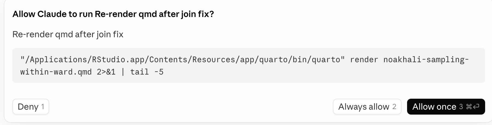
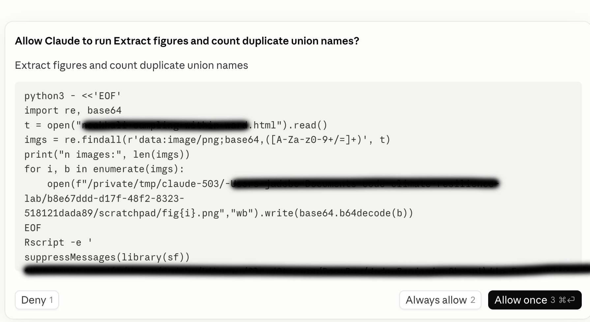

------------------------------------------------------------------------

editor_options: markdown: wrap: 72 ---

# Using generative AI to code

By Jade Benjamin-Chung and Anna Nguyen

AI can be enormously useful in writing code for research. Currently, there are two main ways to use it, and the distinction is important:

- **Chat-based help**: asking a chatbot to explain a function or debug a pasted error in an app or website. You copy/paste code back and forth. If data is ever provided to it, it must be manually uploaded. You have a high degree of agency over data access and what code to run, when, and where.
- **Agentic coding tools** run directly in your terminal or code editor (e.g., RStudio), can read and edit files across your project, execute code, run tests, and iterate on its own output — all with a degree of autonomy that you grant it. It can plan a multi-step task, write and execute code across several files, install packages, and run analyses with minimal intervention. This is powerful, but it also means more can happen without your direct review at each step. That's why coding with these tools is called "vibe coding". Agentic tools include Claude Code, Codex, Gemini CLI, Cursor, and Github Co-Pilot.

Both modes are useful, but they each pose different risks to learning and to research safety and accuracy. This chapter includes our Lab Policy on use of AI in Research and then discusses the rationale.

## Benjamin-Chung Lab Policy on use of AI in Research

::: policy-box
- **Lab members must use [Stanford-licensed enterprise AI tools](https://uit.stanford.edu/ai/connectors)** (Claude for Education, ChatGPT Edu, Gemini Enterprise) for all research-related work involving lab data, code, or drafts. These tools carry Stanford's data protection and institutional agreements; personal/free-tier accounts do not.

- **Tool choice must match the data risk level and requirements in the IRB protocol and Data Use Agreement, if applicable.**

  - **Low risk** (e.g., public data, non-sensitive code, general drafts): any Stanford-licensed enterprise tool may be used.
  - **Moderate risk** (e.g., de-identified data, unpublished results, internal code, grant/manuscript drafts): Stanford-licensed enterprise tools only — no personal or free-tier accounts.
  - **High risk / PHI** (e.g., identifiable or participant-level data, protected health information): only tools explicitly approved for this risk tier may be used, and only after confirming with Jade that the specific tool and use case are permitted under the project's IRB protocol and data use agreement. Some Stanford-licensed tools may not be approved for PHI use even if generally approved for lab work — check before proceeding.

- **No lab data, code, or manuscripts can be used in non-approved tools.** This includes participant data (even de-identified), unpublished results, grant drafts, IRB materials, and internal code — never paste or upload these into a personal ChatGPT account, a non-Stanford API key, or any tool outside the approved list. If a project genuinely requires a tool outside the approved list, you must get explicit permission from Jade in writing before use.

- **Agentic tools (Claude Code, Codex, Cowork, Gemini CLI, etc.) require extra caution.** Because these tools can read, write, and execute code or take actions autonomously, always: Review generated code/output before running or committing it. Never grant an agentic tool access to production data, credentials, or shared drives without lab PI approval. Disclose if an agentic tool was used to produce analysis code, and document this in commit messages or code comments.

- **Follow lab guidelines on Agentic AI permissions:** Always leave the tool's permission mode on default (the setting that asks before making edits or running commands) — never switch to a mode that lets the AI act without asking first. Our lab uses exactly two settings files plus a guidance file (see the permissions section below): the shared project `.claude/settings.json` committed in each repo, your personal `~/.claude/settings.json`, which exists only to hold `deny` rules protecting raw datasets in your local Box folder, and a shared `CLAUDE.md` in each repo for advisory project context. Never use a personal settings file (`~/.claude/settings.json` or a `settings.local.json`) to add `allow` rules, relax `ask` rules, or change the permission mode for lab projects.

- **Humans are responsible for Git commit and Git push, not AI.** Because research errors are analytical rather than technical and often can't be caught by automated checks, every lab member must personally write and execute their own commits and pushes — this keeps the reasoning behind each change with the person responsible for it, and builds the judgment mentees need to develop.

- **When in doubt, ask first.** It's always acceptable — and preferred — to check with Jade before using a new tool or changing permission settings, rather than after.

- **You must complete a short quiz and agree to the lab's AI use policy** before using any AI tool for research in the [Benjamin-Chung Lab AI Use in Research Permission Form](https://forms.gle/6ZGJBDY9Qqq3Jn1j6)

- **Use of AI tools in research must be documented** in the [Benjamin-Chung Lab AI Use in Research Documentation Form](https://docs.google.com/forms/d/e/1FAIpQLScphiuDTkUXH0RVFFuj-I4KqgmxXP796MfV9mLeQ2uY8k9mgA/viewform?usp=publish-editor)
:::

## Three key issues

1.  **Learning and skill development.** Heavy reliance on AI coding tools may impede the development of coding fluency and statistical/computational intuition — particularly for trainees who are still building these skills.
2.  **Research accuracy.** Using these tools on datasets, analysis types, or workflows you aren't already familiar with raises the risk of subtle errors going undetected, because you may lack the intuition to recognize when something looks wrong.
3.  **Data protection.** These tools can access files on your machine, which introduces new and sometimes subtle data-handling risks in a research context governed by IRB protocols, data use agreements, and participant privacy commitments.

Each is discussed in more detail below, along with suggested safeguards.

## Guiding principles

AI coding assistants are a powerful addition to our computational toolkit, but they are not a substitute for the judgment that comes from hands-on coding experience, nor for careful attention to data governance. Use them deliberately: lean on them more for familiar, low-stakes tasks, and less for unfamiliar or high-stakes ones, with unit tests, replication checks, and careful permission review as standing practice regardless of experience level.

**When in doubt about whether a workflow is compliant, ask Jade before proceeding.**

### Potential risks of using generative AI in education

**Little to nothing is currently known about the pedagogy of learning to code with AI assistance versus learning to code without it.** If you never manually write code — if you never sit with a bug for twenty minutes and slowly figure out that the join key had a leading whitespace — how do you develop the gut instinct described above? We don't know.

It's also possible that this concern will turn out to be less important than it seems. The future of research computing may not involve much hands-on human coding at all. But even if that's true, we don't yet know *how* to teach someone — a rotation student, a new Research Assistant, a first-year PhD student — to "vibe code" well: to direct an AI tool effectively, to catch its mistakes, and to build sound judgment about when to trust its output. Until the pedagogy of computational research with agentic AI exists, in our lab, we consider risks of agentic AI use to be high for early-career skill-building to be high.

### Potential risks of using generative AI in research

#### Risk: errors lead to incorrect scientific conclusions

In 2026, most seasoned quantitative researchers have been writing code for a decade or more — tens of thousands of cumulative hours. There's a popular "rule" that [it takes 10,000 hours](https://en.wikipedia.org/wiki/Outliers_(book)) to master a new skill-- equivalent to 5.5 years of full time work. That experience builds a kind of gut instinct: when you look at code, or watch it run, you develop a sense for what *might* be going wrong, even when nothing throws an obvious error. Examples of silent failures:

- A merge that drops rows unexpectedly
- A factor variable that got silently releveled
- A date field parsed in the wrong timezone

After dealing with these silent errors hundreds or thousands of times, the human brain recognizes the *shape* of a subtle bug before you can necessarily articulate exactly what it is. That experience is what lets seasoned researchers know what safeguards to put in place:

- Which unit tests are worth writing
- Which portions of a work flow require human or independent agentic replication checks
- Which outputs deserve a manual sanity check versus which can be trusted.

AI coding tools do not have this judgment about *your specific project*. They can write tests if asked, but deciding *which* tests matter for a given dataset or analysis is still a human judgment call, grounded in domain and data familiarity.

This means the risk of using these tools is not constant. As your mentor, I am working on developing systems to help you learn when you might be in the **danger zone**. When you're in the danger zone, you are outside your area of established expertise, working with a new data source, an unfamiliar analysis method, or a computational workflow you haven't run by hand before. The challenge is, when you're new to a project or to a field of study, you're always in the **danger zone.**

#### Risk: potential breaches of confidentiality and IRB / data use agreement violations

Uploading data to a chat-based AI tool poses risks, including:

- Breaches of participant confidentiality
- Violations of IRB protocols and data use agreements,
- Loss of control over how the data is stored, retained, or used to train future models. Even de-identified datasets can sometimes be re-identified when combined with other information, and many AI tools' terms of service permit them to retain or process uploaded content in ways that are not fully transparent to the user.

The risks are substantially higher for agentic tools such as Claude Code that run locally and, with your permission, can read and modify files on your laptop — including, potentially, files containing participant-level data governed by IRB protocols and data use agreements.

The practical risk is subtler than "the AI leaks your data." During a coding session, the tool may generate hundreds of permission requests (to read a file, run a command, install a package, access the network, etc.). These prompts are sometimes phrased in dense technical language that is genuinely hard to parse quickly. It is easy to click "allow" reflexively and inadvertently grant access to a raw data directory, or permission to send data over the network (e.g., installing a package, calling an external API), without fully registering what you approved. This is not primarily a malicious-AI risk; it's a human-factors risk.

As of June 2026, [Stanford's Approved Connectors for AI Services](https://uit.stanford.edu/ai/connectors) have different different risk categories by different products. Note that Google and OpenAI can be used with High Risk [Protected Health Information (PHI)](https://med.stanford.edu/irt/security/stanfordinfo/hipaa.html) data, while using PHI with Claude requires routing through the Stanford AI API Gateway. If you are not sure whether you your project is using PHI, check with Jade before proceeding.

## Configuring permissions for agentic AI

This section covers Claude Code's **permission system**. This guidance won't necessarily work in other agentic tools (Cursor, Codex CLI, OpenCode, etc.), each of which has its own config format and varying hook support. If you're using a different agent, you would need to look up that tool's own permissions/hooks documentation and check with Jade to ensure compliance.

The overarching goal of these permissions is to prevent agents from modifying raw data or interacting with it outside of a secure environment.

Any workflows that use high-risk data or files that contain PHI must only use Claude Code through the [Stanford AI API Gateway](https://uit.stanford.edu/service/ai-api-gateway). When working with the AI API Gateway, always double check that you are using the correct API key and that your session is routed through the Gateway (check that"ANTHROPIC_BASE_URL" is set to "<https://aiapi-prod.stanford.edu>"). Our template CLAUDE.md file includes a reminder to check this at the start of every session.

If you use agentic tools without the AI API Gateway - even if you're using a Stanford Enterprise account - you must make a deidentified copy of the data and remove all PHI before allowing an agent to read it. If PHI is needed for your analyses (ie you need to stratify by age/gender), only retain the minimal set of necessary identifying columns and permute and/or add noise to their values. Once your code is finished, you must manually run the analyses on the original data.

Claude Code has several permission modes that set the baseline approval behavior for a session. **default mode** requires explicit approval for every action other than reads — every:

- file edit
- shell command
- network call

gets a permission prompt. This is the only mode that guarantees a human is in the loop, which matters given that our work involves participant data and code that feeds into published analyses. Other modes exist, but they trade oversight for speed in ways that aren't appropriate for research in our lab without explicit permission from Jade.

### Setting up permissions

Our lab setup uses **three files that work together**:

1.  **A shared project settings file** *with rules that are* enforced\*. — `.claude/settings.json` in each repo's root folder, committed and pushed to GitHub. The Claude Code software checks them before any action runs, so a denied command never executes, no matter what the AI intends. Anyone who clones the repo gets these rules automatically.
2.  **A shared `CLAUDE.md` project file** *that contains conventions and context and is advisory*. It's a plain-English file in the repo's root that Claude reads at the start of each session — project context, lab conventions, how we work. Claude genuinely tries to follow it, but nothing enforces it: the model can forget it in a long session or weigh it against other instructions. Save it in each repo's root folder and commit and push it to GitHub.
3.  **A personal settings file** — `~/.claude/settings.json` in your home folder, one per person per computer. It carries the only enforced rules that can't be shared: the `deny` rules protecting **raw datasets**, which are typically in your local Box folder, because Box lives at a different local path on each computer and each person has access to different datasets. The Claude Code software checks them before any action runs, so a denied command never executes, no matter what the AI intends.

### Template: Shared project settings file

Save this `.claude/settings.json` file in each project's root folder and push it to GitHub so it's version-controlled and shared by everyone working in that repo:

``` json
{
  "permissions": {
    "defaultMode": "default",
    "allow": [
      "Read(./**)",
      "Bash(git show*)",
      "Bash(git status*)",
      "Bash(git diff*)",
      "Bash(git branch*)",
      "Bash(git log*)",
      "Bash(git fetch*)",
      "Bash(Rscript *)",
      "Bash(quarto *)"
    ],
    "ask": [
      "Bash(git checkout*)",
      "Bash(pip install *)",
      "Bash(pip3 install *)",
      "Bash(curl *)",
      "Bash(rm *)",
      "Bash(npm install *)",
      "Bash(conda install *)",
      "Bash(apt-get install *)",
      "Bash(apt install *)",
      "Bash(python *)",
      "Bash(python3 *)",
      "Bash(Rscript PATH/TO/YOUR-INTENSIVE-SCRIPT.R)"
    ],
    "deny": [
      "Bash(git add*)",
      "Bash(git commit*)",
      "Bash(git push*)",
      "Bash(git merge*)",
      "Bash(git rebase*)",
      "Bash(git reset*)",
      "Bash(rm -r*)",
      "Bash(rm -fr*)",
      "Bash(rmdir *)",
      "Bash(sbatch:*)",
      "Bash(srun:*)",
      "Bash(salloc:*)"
    ],
    "additionalDirectories": []
  }
}
```

**What every line of this file means, in plain English:**

**Top-level settings**

| Setting | Plain-English explanation |
|------------------------------------|------------------------------------|
| `"defaultMode": "default"` | Claude must ask before each file edit, shell command, or network call (e.g., calling an external API, installing packages from the internet). Because this lives in the repo, the setting travels with the project and get pushed to Github. |
| `"additionalDirectories": []` | Claude Code treats the folder you opened it in (the repo) as its workspace. additionalDirectories extends Claude's access to other folders. If left empty, Claude can only work inside the project folder itself. |

**`allow` — Claude does these without asking** (read-only or low-risk actions):

| Rule | Plain-English explanation |
|------------------------------------|------------------------------------|
| `Read(./**)` | Claude can read any file inside the project folder. (But it can never read any folders - ex raw-data - protected by your personal settings file, described below.) |
| `Bash(git show*)`, `Bash(git status*)`, `Bash(git diff*)`, `Bash(git branch*)`, `Bash(git log*)`, `Bash(git fetch*)` | Claude can look at the state and history of the git repository. These commands are informational only — none of them rewrite history or touch your uncommitted changes. |
| `Bash(Rscript *)`, `Bash(quarto *)` | Claude can run R scripts and render Quarto documents. |

**`ask` — Claude must ask you first, every time** (actions that change state or reach outside the repo):

| Rule | Plain-English explanation |
|------------------------------------|------------------------------------|
| `Bash(git checkout*)` | Switching branches can silently discard uncommitted work, so you approve it each time, even though it doesn't touch remote history. |
| `Bash(pip install *)`, `Bash(pip3 install *)`, `Bash(npm install *)`, `Bash(conda install *)`, `Bash(apt-get install *)`, `Bash(apt install *)` | Installing packages or dependencies reaches outside the repo and changes your computing environment, so each install needs your approval. |
| `Bash(curl *)` | Any outbound network request needs your approval. |
| `Bash(rm *)` | Deleting a file. Claude shows you the exact delete command and waits for your approval — this is how Claude can delete an *individual file*, and only with your permission each time. Folder deletion is never allowed; see `deny` below. |
| `Bash(python *)`, `Bash(python3 *)` | Python isn't part of our core R-based workflow; Claude typically writes these scripts on its own to run quick tests or check its work. Approve them individually at first so you can see what it's doing; once you trust a specific recurring script, you can move its exact path to `allow`. |
| `Bash(Rscript PATH/TO/YOUR-INTENSIVE-SCRIPT.R)` | Claude cannot run computationally intensive or destructive scripts without permission. ⚠️ **The path is a placeholder** — replace it with the actual path to a script in your project (e.g., `Bash(Rscript 2-analysis/fit-main-model.R)`), add a line per script, or delete the line if the project has none. Because `ask` is checked before `allow`, a script listed here always prompts even though `Bash(Rscript *)` is in `allow`. |

**`deny` — hard blocks Claude can never perform, even if you say yes:**

| Rule | Plain-English explanation |
|------------------------------------|------------------------------------|
| `Bash(git add*)`, `Bash(git commit*)`, `Bash(git push*)`, `Bash(git merge*)`, `Bash(git rebase*)`, `Bash(git reset*)` | **Humans are responsible for git, not AI.** Lab members must personally write and run their own commits, pushes, merges, rebases, and resets — this keeps the reasoning behind each change with the person responsible for it, and builds the judgment our team needs. Claude can still draft a suggested commit message or explain what changed, but cannot run these commands itself, even with approval. |
| `Bash(rm -r*)`, `Bash(rm -fr*)`, `Bash(rmdir *)` | Claude can never delete a folder — these block recursive deletes (`rm -r`, `rm -rf`, `rm -fr`) and directory removal (`rmdir`) everywhere, with no option to approve them. Because these are global, they also mean Claude can never delete a folder in your Box folder. |
| `Bash(sbatch:*)`, `Bash(srun:*)`, `Bash(salloc:*)` | Claude should not submit Slurm jobs to an external cluster (ex Sherlock). If your project needs to run Slurm jobs, you must do so manually. |

**A note on why we don't recommend having AI responsible for Git commit and push:** Though in industry, agents are increasingly performing Git commits on their own, research code differs from software engineering in ways that change how much autonomy is appropriate. In engineering, continuous integration and test suites can verify correctness before a commit lands, and multiple reviewers typically stand between an AI-drafted commit and production. In our lab, the errors that matter most are analytical, not technical — a mishandling of a missing observation, an incorrect ICD-11 code, an inappropriate mediator — and no automated check can catch these. Further, most of our team are mentees still building that judgment, and if an AI agent can commit once a person clicks "approve," the person approving may not yet have the expertise to catch what's wrong. Requiring each person to write and run their own `git commit`/`git push` keeps a deliberate human decision point before any change becomes part of our shared code base and promotes learning.

Nothing in `ask` or `allow` can override anything in `deny`.

### Template: Shared CLAUDE.md project file

Save this as `CLAUDE.md` in each project's root folder and push it to GitHub. Fill in the bracketed parts for your project; keep the fixed lines of the Data and How-we-work sections as written. Remember this file is *advisory* — it makes Claude work better and explains the why, while the enforcement lives in the settings files above.

Two cautions when filling it in. **Keep the whole file to a page or two** — Claude loads it at the start of every session, so a bloated file wastes the model's attention; link to the pre-analysis plan and codebook rather than pasting their contents (Claude can open those files when it needs them). And **never put anything sensitive in it** — no participant data values, nothing copied from raw datasets — it's a committed, shared file.

``` markdown
# [PROJECT NAME]

[One or two sentences: what study this is, and what this repo does.]

## Study context
- [Design and population, e.g.: cluster-randomized trial of X in Y;
  child-level outcomes, clustering at the village level.]
- [Primary exposure(s) and outcome(s), briefly.]

## Pre-analysis plan
- The pre-analysis plan is at [path in repo or OSF link]. Analyses
  follow it: flag any deviation from the pre-specified outcomes,
  models, or subgroups rather than improvising, and never add
  exploratory analyses unless asked.

## About this repo
- Print ANTHROPIC_BASE_URL at the start of each session, and flag any session where it is not equal to `https://aiapi-prod.stanford.edu` (the Stanford AI API Gateway).
- Analyses are written in R and Quarto. [Describe the folder
  structure, e.g.: scripts run in order from `1-data-cleaning/` to
  `3-figures-tables/`; shared functions live in `0-functions/`.]
- [How to run the pipeline: config file, renv, run order, where
  outputs go. Note any scripts too expensive to run casually.]

## Data
- Raw data lives on Box, outside this repo, and is off-limits to you:
  never read, edit, or delete anything in a raw-data folder.
- Scripts you write may read raw data when they run, but must not
  print row-level data to the console — no `head()`, `print()`, or
  `View()` on identifiable datasets.
- Prefer de-identified or synthetic data during code development.
- The codebook / data dictionary is at [path to de-identified
  codebook in repo].
- [Known dataset gotchas: date formats, site codes, sentinel values
  like -9 for missing, variables recoded mid-study.]

## Conventions
- [Statistical conventions: preferred packages, how missing data are
  handled, survey weights or robust/clustered SEs, etc.]
- Follow the lab coding style guide
  (https://jadebc.github.io/lab-manual/coding-style.html).

## How we work
- This is research code: correctness matters more than speed.
- Analytical decisions — model choice, variable definitions, handling
  of edge cases — go to a human. Say what you are unsure about rather
  than picking silently.
- Humans run all git commits, pushes, merges, and rebases — never run
  these yourself. You may draft commit messages and explain diffs.
- Enforced permissions are in `.claude/settings.json`; do not suggest
  changing or working around them.
```

### Template: Personal settings file

Save this `~/.claude/settings.json` in your home folder. This file protects **raw datasets stored in your local Box folder**. Raw data locations are project-specific, so this file must be updated **every time you get access to a new raw dataset**: add a set of three `deny` lines (`Read`, `Edit`, `Write`) pointing at that dataset's folder in Box, as in this example with two datasets:

``` json
{
  "permissions": {
    "deny": [
      "Read(~/Library/CloudStorage/Box-Box/STUDY-A/raw-data/**)",
      "Edit(~/Library/CloudStorage/Box-Box/STUDY-A/raw-data/**)",
      "Write(~/Library/CloudStorage/Box-Box/STUDY-A/raw-data/**)",
      "Read(~/Library/CloudStorage/Box-Box/STUDY-B/data/untouched/**)",
      "Edit(~/Library/CloudStorage/Box-Box/STUDY-B/data/untouched/**)",
      "Write(~/Library/CloudStorage/Box-Box/STUDY-B/data/untouched/**)"
    ]
  }
}
```

| Rule | Plain-English explanation |
|------------------------------------|------------------------------------|
| `Read(...raw data path...)` | Claude can never read raw data files, so participant data never enters the AI's context (file contents Claude reads are transmitted to the AI provider's servers). |
| `Edit(...raw data path...)`, `Write(...raw data path...)` | Claude can never modify or create anything inside a raw-data folder — raw data stays exactly as collected. |

⚠️ **The paths shown are placeholders** — replace them with the real local Box paths on *your* computer (see the checklist below). A path-based deny rule only protects the exact path it names; if the path doesn't match where the data actually live, the rule silently protects nothing.

Why doesn't this cover all of Box? Box also holds plenty of non-sensitive material — manuscripts, admin files, derived datasets — that we *do* want Claude to be able to read and edit when asked. The deny rules draw the line exactly around the raw datasets.

Note these rules block *Claude's own* file access, not the programs it runs: R scripts that Claude writes and executes can still read raw data normally (see "For data protection" under Best practices below).

**What this means for deleting files — in plain terms:**

- Claude **can delete an individual file, but only after asking you** and receiving your explicit permission for that specific command (`rm` is in the `ask` list of the shared project file).
- Claude **can never delete folders** — not in the project, and **never any folder in Box**. Recursive and folder deletes are in the shared `deny` list, so no approval you give can make them run.
- Claude **can never read, change, write, or remove anything inside a raw-data folder** you've listed in your personal settings file — and no approval can override that either.
- The rest of Box (manuscripts, admin files, derived data) stays readable and editable by Claude, subject to the normal ask-first prompts.

### Setup checklist

**Once per computer:**

- [ ] **Create your personal settings file `~/.claude/settings.json`** in your home folder with the `permissions`/`deny` structure shown in the personal-file template above (start with an empty `deny` list if you don't have raw data access yet).

**Every time you get access to a new raw dataset:**

- [ ] **Add three `deny` lines to your personal settings file for that dataset's Box folder** to your personal `~/.claude/settings.json`. To find the path:

  1.  Open the dataset's raw-data folder in Finder (Mac) or File Explorer (Windows).
  2.  Copy the folder's full path (Mac: right-click the folder, hold **Option**, and choose "Copy ... as Pathname"; Windows: click the address bar). On a Mac with Box Drive this is usually `~/Library/CloudStorage/Box-Box/<folder name>` (or `~/Box/<folder name>` on older installs); on Windows it is usually `C:\Users\<you>\Box\<folder name>`.
  3.  Add that path, followed by `/**`, in a `Read`, an `Edit`, and a `Write` line in the `deny` list.

  > ⚠️ This step matters more than it might look — if the path doesn't match where the data actually live on your computer, the deny rule silently protects nothing. Do this *before* pointing Claude Code at any work involving that dataset.

**Once per project repo (tailor the shared templates):**

- [ ] **Add `.claude/settings.json`** in the repo's root folder, copied from the shared settings template above, and commit it so everyone on the project gets the same rules. Fill in any placeholders (e.g., for intensive scripts).

- [ ] **Add a `CLAUDE.md`** from the template above: fill in the project name, repo structure, and how to run the pipeline; keep the data and git sections as written.

- [ ] **Check whether the project needs additional `allow` tools** Does the project need to list tools in `allow` other than `git`, `Rscript`, `python`, and `python3`? If so, modify this section.

## Understanding agentic AI permission prompts

*Note: the following is based on Claude Code, but other agentic coding tools have similar permission prompts.*

The prompt and approval interface differs depending on whether you're working in a terminal or a GUI/editor-based tool, but the underlying pattern is the same:

- **AI's own plain-English summary** of the action, not a guarantee of what the command actually does. It's usually accurate, but it can omit exactly the detail — a hardcoded file path, a write to an unexpected directory — that matters for review. Read the actual command or diff underneath, not just the summary. 

- **Long commands or file paths that are often truncated.** Claude Code may write a snippet of code and ask you for permission to run it, but it might not be in your project's language, and often these code snippets are not saved in your repository at all. For example, if you're working in an R codebase and ask it to double-check a calculation or validate an assumption, it might quietly reach for Python — writing a small throwaway script to cross-check the logic, run it, read the output, and then report back to you in English. That scratch script often never gets saved as a file you'd see in a pull request; it's more like a post-it note the AI wrote to itself, used once, and threw away. The problem is that if you don't read Python, you have no way to actually verify what that post-it note said or did — you're not reviewing the check, you're reviewing Claude's summary of the check. That might be perfectly fine for something low-stakes, but for a step that's supposed to be your safeguard against a subtle analytic error, it's worth pausing on: if you can't read the language a verification was written in, you aren't really approving the verification — you're approving a description of it, written by the same tool whose work it's supposed to be checking.

Here's an example from a code base entirely written in R, where Claude Code asked for permission to check for duplicates using a "post-it" note in Python.



- **"Always allow" sits right next to the one-time approval**, in the terminal as option 2 of 3, and in the GUI as a persistent button with its own keyboard shortcut. It's one keystroke away from a single-use approval, which is exactly what makes reflexive over-granting easy, especially late in a long session.

When Claude Code (or a similar AI coding assistant) asks for permission to run a command, recognizing the command itself — not just reading the plain-English gloss above it — is the fastest way to know what you're actually approving. The tables below are organized by risk level.

<!-- | **Low-risk commands **|   || -->

<!-- |---|---|---| -->

<!-- | Command | What it does | Why it matters| -->

<!-- | `ls`, `cat`, `head`, `tail` | List directory contents; print file contents || -->

<!-- | `cd`, `pwd` | Change / print working directory || -->

<!-- | `cp` | Copy files || -->

<!-- | `\|` (pipe) | Send one command's output into another as input || -->

<!-- | `&&` | Run the next command only if the previous one succeeded || -->

<!-- | **High-risk commands** |   || -->

<!-- | `rm` | Delete files | No undo. Watch for this near raw data paths | -->

<!-- | `rm -rf` | Force-delete a directory and everything in it, no confirmation | The single riskiest pattern to recognize — `-rf` = recursive + force, can wipe a whole folder tree silently | -->

<!-- | `mv` | Move files | Can silently overwrite a destination file with no confirmation | -->

<!-- | `>`, `>>` | Redirect output to a file (overwrite / append) | `>` silently overwrites the entire target file's contents; easy to miss inside a longer command | -->

<!-- | `sed -i`, `awk` | Edit files in place / process text | `-i` modifies the original file directly — no diff preview the way an Edit-tool prompt gives you | -->

<!-- | `chmod` | Change file permissions | Can make a file world-readable/writable — relevant for data files that should stay restricted | -->

<!-- | `chown` | Change file ownership | Rare in normal analysis work; worth a second look if it appears | -->

<!-- | `find ... -exec` | Search for files, then run a command on each match | Can apply `rm`, `chmod`, etc. across many files at once — read the `-exec` clause carefully | -->

<!-- | `curl`, `wget` | Download content from a URL | Network access — relevant if you're trying to keep data from leaving the machine | -->

<!-- | `scp`, `rsync` | Copy files to/from a remote machine | Data transfer off your machine — deserves close scrutiny with unfamiliar destinations | -->

<!-- | `git push`, `git commit` | Send code changes to version control / record a commit | Worth noticing if you didn't expect Claude to be committing on your behalf | -->

<!-- | `sudo` | Run a command with administrator privileges | Rare and high-risk in a research computing context — should almost never be needed for data analysis | -->

<!-- | `export` | Set an environment variable | Can be used to set API keys, credentials, or paths — worth checking what's being exported | -->

```{r, echo=FALSE, message=FALSE}
library(kableExtra)
library(dplyr)

# Percent widths are valid CSS but break LaTeX (% starts a comment there),
# and backslash widths like \linewidth break kableExtra's own regex on the
# next column_spec call — so for PDF use em widths (~28em usable text width).
col_w <- function(pct) {
  if (knitr::is_latex_output()) {
    paste0(round(pct * 0.28), "em")
  } else {
    paste0(pct, "%")
  }
}

cmds <- tribble(
  ~Command, ~`What it does`, ~`Why it matters`,
  "`ls`, `cat`, `head`, `tail`", "List directory contents; print file contents", "",
  "`cd`, `pwd`", "Change / print working directory", "",
  "`cp`", "Copy files", "",
  "`|` (pipe)", "Send one command's output into another as input", "",
  "`&&`", "Run the next command only if the previous one succeeded", "",
  "`rm`", "Delete files", "No undo. Watch for this near raw data paths",
  "`rm -rf`", "Force-delete a directory and everything in it, no confirmation", "Riskiest pattern to recognize — recursive + force, can wipe a folder tree silently",
  "`mv`", "Move files", "Can silently overwrite a destination file",
  "`>`, `>>`", "Redirect output to a file", "`>` silently overwrites the whole target file; easy to miss mid-command",
  "`sed -i`, `awk`", "Edit files in place / process text", "`-i` modifies the original directly — no diff preview",
  "`chmod`", "Change file permissions", "Can make a data file world-readable/writable",
  "`chown`", "Change file ownership", "Rare in normal analysis work; worth a second look",
  "`find ... -exec`", "Search files, run a command on each match", "Can apply `rm`/`chmod` across many files — read the `-exec` clause carefully",
  "`curl`, `wget`", "Download content from a URL", "Network access — relevant if data shouldn't leave the machine",
  "`scp`, `rsync`", "Copy files to/from a remote machine", "Data transfer off-machine — scrutinize unfamiliar destinations",
  "`git push`, `git commit`", "Send code / record a commit", "Notice if Claude is committing on your behalf",
  "`sudo`", "Run with admin privileges", "Should almost never be needed for data analysis",
  "`export`", "Set an environment variable", "May set API keys/credentials — check what's exported"
)

cmds %>%
  kbl() %>%
  kable_styling(
    bootstrap_options = c("striped", "condensed"),
    full_width = FALSE,
    font_size = 12
  ) %>%
  column_spec(1, width = col_w(18)) %>%
  column_spec(2, width = col_w(40)) %>%
  column_spec(3, width = col_w(42)) %>%
  pack_rows("Low-risk commands", 1, 5, label_row_css = "background-color: #eee;") %>%
  pack_rows("High-risk commands", 6, 18, label_row_css = "background-color: #f8d7da;")
```

## Best practices

### For learning and skill development

- **Spend meaningful time writing core analysis code by hand** before leaning on agentic tools for that same type of task — e.g., write your first TMLE or IPW pipeline yourself before asking an AI tool to generate one.
- When using an AI tool for a task you're still learning, **ask it to explain its reasoning**, not just produce output. Treat it as a tutor for code you then re-derive yourself, not a black box.
- Before fully letting agentic AI write a script for you, try writing out detailed pseudo-code -- aka, **a step-by-step plan for what the code should do**. Then ask the AI to implement that plan, and check that it actually does what you intended.

### For research accuracy

- **Match AI use to familiarity.** Use these tools most freely for boilerplate, refactoring, and workflows you already know well. Increase manual scrutiny — or avoid heavy AI use — for new datasets, unfamiliar methods, or unfamiliar computational environments.

- **Use unit tests** for AI-assisted analysis code, especially for anything going into a manuscript or grant deliverable. Ideally, you write these, not an agent, and you confirm the tests actually check the right things. *Learn more in the chapter: Data validation and unit testing in Chapter* \@ref(data-validation)*.*

- **Spot-check intermediate outputs**, not just final results — row counts after joins/merges, variable distributions before and after recoding, and sample sizes at each analytic step.

- **Set up automated logging** to track what files agents have edited. Read about it [here](https://dev.to/boucle2026/how-to-see-everything-claude-code-does-audit-trail-hook-1g9j).

- **Perform independent replication** for key analyses: have a second team member reproduce a critical result from raw data, ideally without heavy reliance on the same AI-generated code path. In the kind of research we do, the code most likely to lead to a lack of replication arises during data processing, i.e., converting survey data to the form needed for analyses. Two reasonable people or agents could make different assumptions, none of which are wrong, that result in different data. Replication brings these differences to light and allows them to be transparently reconciled. Learn more [here](https://gatesopenresearch-files.f1000.com/manuscripts/14274/333a74aa-51bb-44a9-af2b-209f67c2c425_13108_-_jade_benjamin-chung.pdf?doi=10.12688/gatesopenres.13108.1&gtmKey=GTM-MWFK8L5J&gtmAuth=hzk0Vc3qFsQYhCrIoHz68A&gtmPreview=env-1&immUserUrl=https%3A%2F%2Fgates-proxy.f1krdev.com%2Feditor%2Fmember%2Fshow%2F&otid=275477bf-f17b-474f-befe-635d8fa9661a&s3BucketUrl=https%3A%2F%2Fgatesopenresearch-files.f1000.com&submissionUrl=%2Ffor-authors%2Fpublish-your-research&transcendEnv=cm&transcendId=ef49a3f1-d8c1-47d6-88fc-50e41130631f&numberOfBrowsableCollections=5&numberOfBrowsableInstitutionalCollections=0&numberOfBrowsableGateways=14).

- **Practice password safety**: Don't put passwords, SSH keys, or API tokens in any file that an AI tool can read. Don't paste passwords or keys into code or notebooks. Don't leave credential files (like SSH keys) in folders that an AI coding tool has access to. **Keep passwords and keys in a password manager, not in your files**.

### For data protection

- **Ensure your datasets are backed up** in locations that cannot be accessed by agentic AI tools to prevent accidentally overwriting or deleting data.
- **Never point an AI coding tool at a directory containing raw participant-level data** unless you have specifically confirmed this is permitted under the relevant IRB protocol and data use agreement. Work with de-identified or synthetic data during code development, applying finished code to real data only in a controlled step.
- **Read permission prompts before approving them**, especially requests to access the network, install packages, or read/write outside the current project folder.
- **Use project-level permission scoping** instead of granting broad or session-wide access. This is why our lab uses a shared `.claude/settings.json` (allow-listing specific directories and commands, mode set to default), with personal settings reserved for *adding* raw-data `deny` rules only (see above). Don't work around the shared file with a personal `settings.local.json` or broader access than the project file grants.

**When in doubt about whether a workflow is compliant, ask Jade before proceeding.**

## Disclosing use of generative AI in research

Lab members must disclose GenAI use in research at four points:

1.  Within the lab, to Jade using the [Benjamin-Chung Lab AI Use in Research Documentation Form](https://docs.google.com/forms/d/e/1FAIpQLScphiuDTkUXH0RVFFuj-I4KqgmxXP796MfV9mLeQ2uY8k9mgA/viewform?usp=publish-editor)
2.  To collaborators, whenever their data or materials are involved
3.  To journals, at time of submission (see below)
4.  To funders, when their policies require it.

## Know your target journal's AI policy before you start

Before you start a project that will be published in a peer-reviewed journal, keep in mind that you will likely need to disclose any AI assistance in your methods section, acknowledgments, or cover letter. Journal policies on AI use vary widely (see table below).

- Before relying on AI tools for a substantial part of your workflow, check the current policy for your intended journal to learn what it does and doesn't cover — a policy permitting AI for language editing is not the same as one permitting it for analysis or figure generation.
- Document what tools you use throughout the project so you can disclose them at the time of journal submission.
- Given how quickly tools are changing, you'll need to check the policy again closer to submission.

Here is an example of the type of acknowledgement language you might include in a manuscript:

> Claude (Sonnet 4.6, Anthropic) was used for language editing and improving clarity of expression. Claude Code (Sonnet 4.6, Anthropic) was used to assist with data processing, statistical coding, and figure and table generation. All code was reviewed by two independent team members to verify accuracy and reproducibility. These tools were not used to develop research questions, interpret findings, or draw conclusions. The authors take full responsibility for the interpretations, conclusions, accuracy, and integrity of the work.

The following was generated by Claude in July 2026:

```{r ai-journal-policies, echo=FALSE}
library(knitr)
library(kableExtra)

ai_policies <- data.frame(
  Publisher = c(
    "Springer Nature", "PLOS", "Elsevier/Lancet", "BMJ", "Oxford UP", "Wiley",
    "ACS", "ASM", "AAAS/Science", "F1000",
    "ASTMH", "APHA", "eLife", "NIEHS", "Wolters Kluwer", "Cambridge UP"
  ),
  Journals = c(
    "Nature, Nat. Comms/Med/Health, Sci. Reports, BMC, Discover Env.",
    "Glob. Public Health, Medicine, NTD",
    "Lancet GH/PH, eBioMed, eClinicalMed, Vaccine, IJHEH, Heliyon",
    "BMJ Open, BMJ Glob. Health",
    "AJE, IJE, Epi Reviews, CID, JID, OFID",
    "Stats in Med, TMIH, Paediatric & Perinatal Epi",
    "Env. Sci. & Tech.",
    "Applied & Env. Micro.",
    "Science",
    "Gates Open Research",
    "AJTMH", "AJPH", "eLife", "EHP", "Epidemiology", "J. Clin. & Trans. Sci."
  ),
  Policy = c(
    "\U0001F6AB Authorship; \u2705 copy-edit w/ disclosure; name tool + use in Methods",
    "\U0001F6AB Authorship; tool/use/validation disclosed in Methods/Ack.",
    "\U0001F6AB Authorship; \u2705 copy-edit w/ disclosure; declaration before references",
    "\U0001F6AB Authorship; described in manuscript + flagged at submission",
    "\U0001F6AB Authorship; \u2705 coding/analysis w/ disclosure; cover letter + Methods/Ack.",
    "\U0001F6AB Authorship; \u2705 copy-edit w/ disclosure; \U0001F6AB data alteration; Methods/Ack. if substantial",
    "\U0001F6AB Authorship; disclosed in Ack., Methods if substantial",
    "\U0001F6AB Authorship; cover letter + Materials & Methods",
    "\U0001F6AB Authorship; cover letter + Ack. + full prompts in Methods",
    "\U0001F6AB Authorship; not detailed \u2014 check w/ editor",
    "\u2753 Not located \u2014 verify before use",
    "\u2753 Not located; \U0001F5BC\uFE0F AI images must be disclosed",
    "\u2753 Not located \u2014 verify before use",
    "\u2753 Not located \u2014 verify before use",
    "\u2753 Not located \u2014 verify before use",
    "\u2753 Not located \u2014 verify before use"
  ),
  stringsAsFactors = FALSE
)

ai_policies %>%
  kbl(
    col.names = c("Publisher", "Journals", "Policy (\U0001F6AB not permitted / \u2705 allowed w/ disclosure / \u2753 not addressed)"),
    caption = "Journal AI policies as of proposal writing \u2014 policies change, verify current policy before heavy AI use."
  ) %>%
  kable_styling(
    bootstrap_options = c("striped", "condensed"),
    full_width = FALSE,
    font_size = 12
  ) %>%
  column_spec(1, width = col_w(15)) %>%
  column_spec(2, width = col_w(30)) %>%
  column_spec(3, width = col_w(55)) %>%
  pack_rows("Policy documented", 1, 10, label_row_css = "background-color: #eee;") %>%
  pack_rows("Policy not yet located \u2014 check before use", 11, 16, label_row_css = "background-color: #f8d7da;")
```

*Sources: publisher policy pages accessed July 2026 (springernature.com, journals.plos.org, elsevier.com, authors-bmj-com, academic.oup.com, wiley.com, researcher-resources.acs.org, journals.asm.org, science.org, f1000research.com). Cells marked "not located" should be re-checked directly before submission — this space is evolving fast.*
