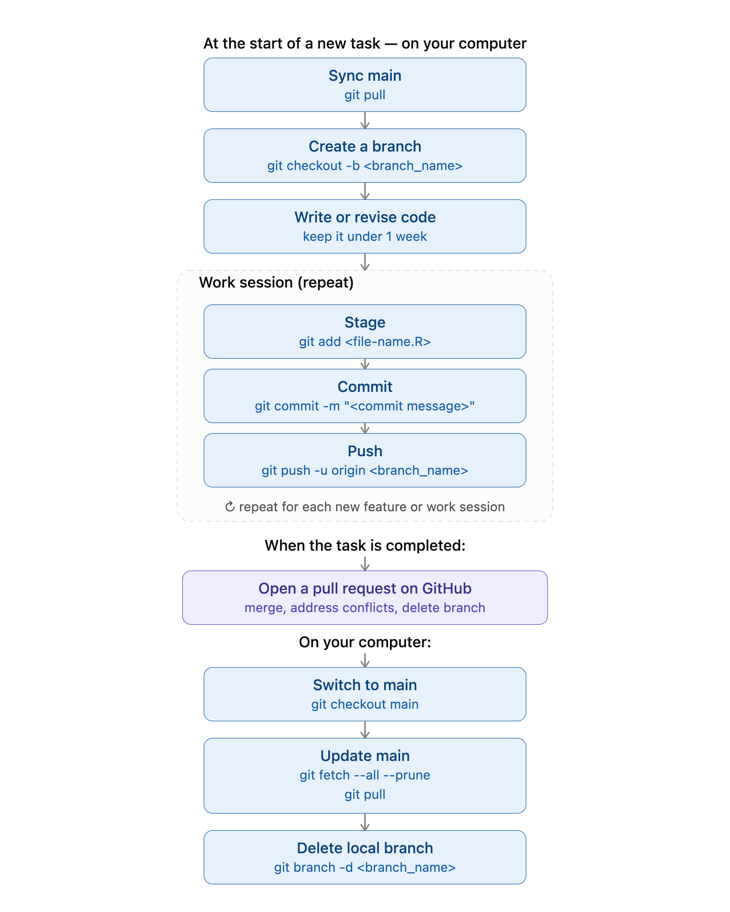

# Github {#github}

by Stephanie Djajadi, Nolan Pokpongkiat, and Jade Benjamin-Chung

## Basics
[GitHub](https://github.com/) is a cloud-hosted platform built around Git, the version control system that tracks every change made to a set of files over time. It is a very powerful tool used in professional software engineering. In our research group, we only use a sliver of its features for version control and lightweight collaboration. If our project's code base is a tree, the main, stable version of the code is kept in the trunk. Branches keep individual analysis tasks (a new script, a revised model, a data cleaning step) separate from the stable version of the code until they're reviewed and merged, and pull requests give a lab member a chance to look over changes before they become part of the main codebase. The goal is to have a reliable history of who changed what, when, and why, and a shared version of code that everyone is working from.

A detailed tutorial of Git can be found [here](https://docs.github.com/en/get-started/start-your-journey/hello-world).

## Github in Command Line vs. Github Desktop
There are two main ways to interact with GitHub: through the command line or using a graphical interface. On a Mac, command line means using Terminal. On Windows, command line means using Gitbash. While knowing how to use Git on the command line will always be useful since the full power of Git and its customizations and flexibilty is designed for use with the command line, Github also provides [Github Desktop](https://desktop.github.com/) as an graphical interface to do basic git commands; you can do all of the basic functions of Git using this desktop app. Feel free to use this as an alternative to Git on the command line if you prefer.

## Git Branching
Branches allow you to keep track of multiple versions of your work simultaneously, and you can easily switch between versions and merge branches together once you've finished working on a section and want it to join the rest of your code. Here are some cases when it may be a good idea to branch:

* You may want to make a dramatic change to your existing code (called refactoring) but it will break other parts of your project. But you want to be able to simultaneously work on other parts or you are collaborating with others, and you don’t want to break the code for them.
* You want to start working on a new part of the project, but you aren’t sure yet if your changes will work and make it to the final product.
* You are working with others and don’t want to mix up your current work with theirs, even if you want to bring your work together later in the future.

A detailed tutorial on Git Branching can be found [here](https://sp19.datastructur.es/materials/guides/using-git#e-git-branching-advanced-git-optional). You can also find instructions on how to handle merge conflicts when joining branches together.

## Example Workflow

A standard workflow when starting on a new project and contributing code looks like this:

  

| Command   | Description      |
| --------- | ---------------- |
| **FIRST TIME ONLY:** `git clone <url> <directory_name>`                  | Clone the repo. This copies of all the project files in its current state on Github to your local computer. |
| 1. `git pull` or `git pull origin main`                            | update the state of your files to match the most current version on GitHub |
| 2. `git checkout -b <new_branch_name>`                 | create new branch that you'll be working on and go to it. Describe the task - don't put your name!  |
| 3. Write or revise code | work on your feature/implementation | 
| 4. `git add <file-name.R>`                               | add changes to stage for commit |
| 5. `git commit -m <commit message>`                    | commit files with a brief descriptive message of the change |
| 6. `git push -u origin <branch_name>`                  | push branch to Github and set to track (-u only needed if this is first push)   |
| 7. Repeat step 4-6. | work and commit often |
| 8. `git push` | push work to Github branch for others to view |
| 9. [Submit a pull request (PR) on GitHub online](https://help.github.com/en/github/collaborating-with-issues-and-pull-requests/creating-a-pull-request#creating-the-pull-request) | PR merges in work from your branch into master |
| (10.) Your changes and PR get approved, your reviewer deletes your remote branch upon merging | |
| 11. `git fetch --all --prune`                           | clean up your local git by untracking deleted remote branches   |
| 12. `git branch -d <new_branch_name>`                           | clean up your local git by deleting local branches that have been merged to main  |

Other helpful commands are listed below.

## Commonly Used Git Commands

| Command   | Description      |
| --------- | ---------------- |
| `git clone <url> <directory_name>`                  | clone a repository, only needs to be done the first time |
| `git pull origin master`                            | pull from `master` before making any changes |
| `git branch`                                        | check what branch you are on   |
| `git branch -a`                                        | check what branch you are on + all remote branches   |
| `git checkout -b <new_branch_name>`                 | create new branch and go to it (only necessary when you create a new branch)   |
| `git checkout <branch name>`                        | switch to branch   |
| `git add <file name>`                               | add file to stage for commit   |
| `git add -p`                                        | adds changes to commit, showing you changes one by one
| `git commit -m <commit message>`                    | commit file with a message   |
| `git push -u origin <branch_name>`                  | push branch to remote and set to track (-u only works if this is first push)   |
| `git branch --set-upstream-to origin <branch_name>` | set upstream to `origin/<branch_name>` (use if you forgot -u on first push)   |
| `git push origin <branch_name>`                     | push work to branch   |
| `git checkout <branch_name>` \ `git merge master`   | switch to branch and merge changes from `master` into `<branch_name>` (two commands) | 
| `git merge <branch_name> master`                    | switch to branch and merge changes from `master` into `<branch_name>` (one command) | 
| `git checkout --track origin/<branch_name>`         | pulls a remote branch and creates a local branch to track it (use when trying to pull someone else’s branch onto your local computer)   |
| `git push --delete <remote_name> <branch_name>`     | delete remote branch   |
| `git branch -d <branch_name>`                       | deletes local branch, -D to force   |
| `git fetch --all --prune`                           | untrack deleted remote branches   |

## How often should I commit? 
It is good practice to commit every 15 minutes, or every time you make a significant change. It is better to commit more rather than less. 

## What not to put on Github
Please do not push any of the following to Github:

- Research data - Github is not a proper data repository! 
- RStudio project files (.Rproj) - these are user-specific and can cause merge conflicts. If you want to share your RStudio project, consider sharing the source code and instructions for how to set up the project instead.
- html files generated by Quarto or RMarkdown. When there are merge conflicts for html files, they are notoriously difficult to resolve. If you want to share your html files, consider using a shared Google Drive or Dropbox folder instead. Users can render the html files from the source code on Github.
- Log files (e.g., .Rout) - it is incredibly difficult to reconcile conflicts in logs. If you run logs, keep them on your own system or (preferably) set up a shared directory where all logs are name and date timestamped. 
- .DS_Store files - these are Mac-specific and not needed for your project. You can add a .gitignore file to your project to ignore these files.

## What should be pushed to Github?
- All R scripts (or Python scripts, or other source code) that are part of your project.
- `.gitignore`, which contains instructions about which files we agree should not be tracked by Git. There is a standardized `.gitignore` for `R` which you [can download](https://github.com/github/gitignore/blob/master/R.gitignore) and add to your project. This ensures you're not committing log files or things that would otherwise best be left ignored to GitHub. 

## More resources
- Summary of Github commands [Section B](https://sp19.datastructur.es/materials/guides/using-git#b-local-repositories-narrative-introduction).
- If you have made a mistake in Git, you can refer to this [article](https://sethrobertson.github.io/GitFixUm/fixup.html) to undo, fix, or remove commits in git.
